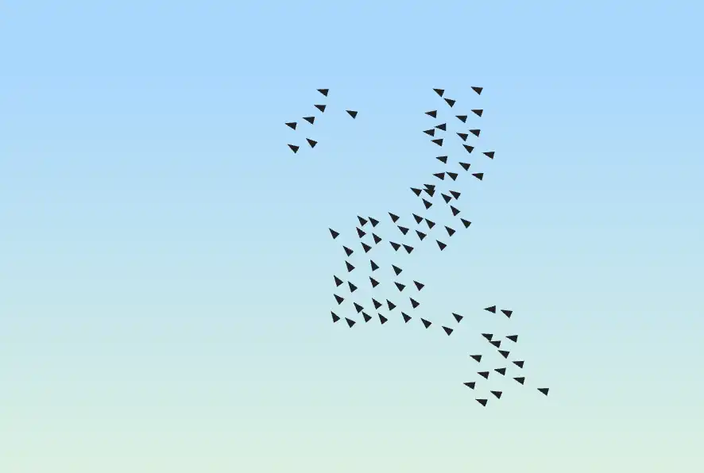

An implementation of the boids algorithm. Each boid (bird-oid) follows three simple rules: separation, alignment and cohesion. The result is a mesmerizing simulation of a flock of birds or school of fish.

This is also an excellent example of emergent behavior in swarm intelligence; where complex group behavior arises from simple individual rules.
