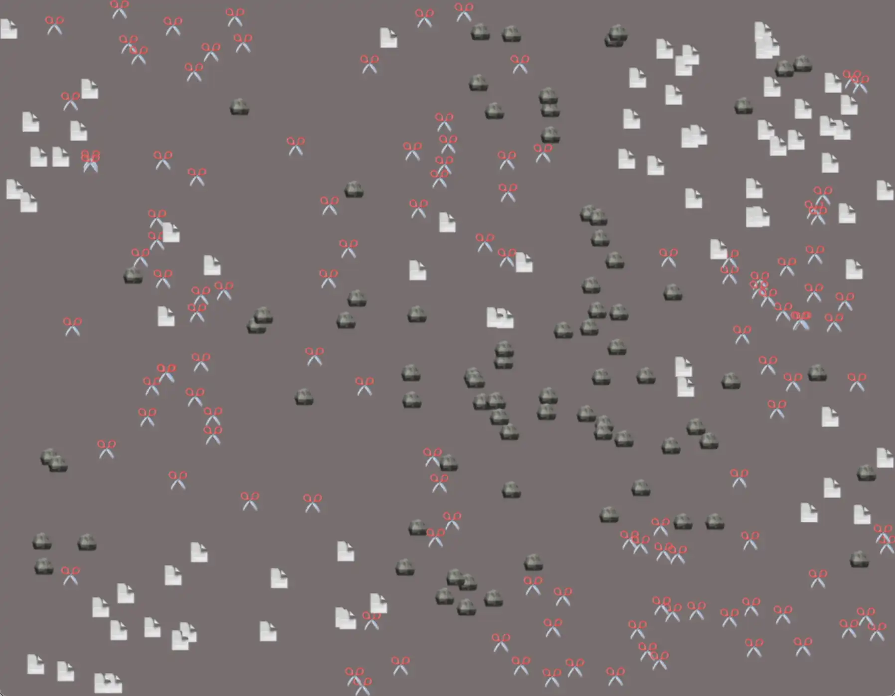

Emulates a foodchain with rock-paper-scissors rules. If one species hunts another to extinction, it will also go extinct. Each population size fluctuates like in nature, based on the number of predators and prey. Really mesmerizing to watch.
