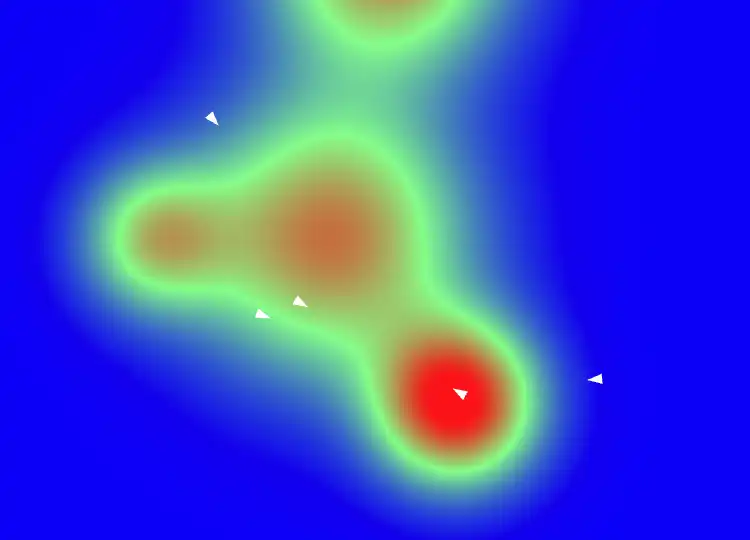

An implementation of the Particle Swarm Optimization (PSO) algorithm. PSO is a computational method used for optimization problems, inspired by the social behavior of birds flocking or fish schooling.

In this simulation, particles move through the solution space to find the optimal solution by updating their positions based on their own experience and that of their neighbors. I also created a modified version where the particles mimic the movements of moths around a light source.
