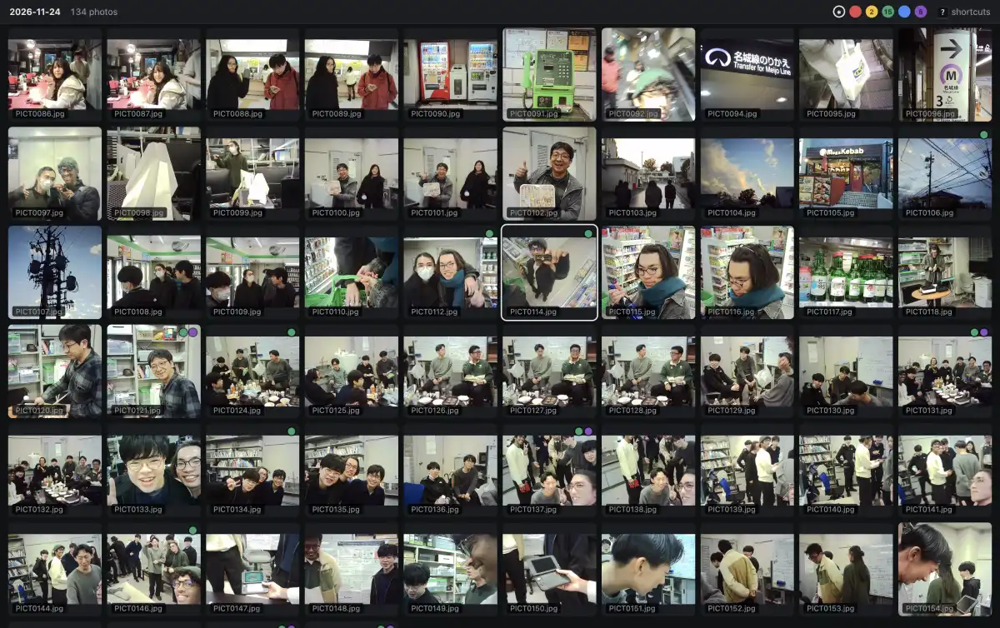

Fast, keyboard-driven photo culling for a folder of JPGs. One Rust binary serves a local web UI.

I made it to sort pictures from my Charmera. An iPhone can read the SD card over USB-C, but the process is hella tedious. It only shows one photo at a time unless you import everything into the camera roll first, and rotating an image once it's there is even worse. Finder was too slow. Takes an eternity rotating an image, the grid view is useless, and there are few to none useful keyboard shortcuts.

Pothos shows the whole folder as a grid, rotates losslessly with one key (it only changes the EXIF orientation flag), tags photos with colors, and sends the picks to the iPhone with AirDrop.

Built with Rust (axum and tokio), plain HTML, CSS and JS, and a small Swift helper for AirDrop. Runs on macOS.

The project is named Pothos after a pretty house plant that happens to sound like photos.