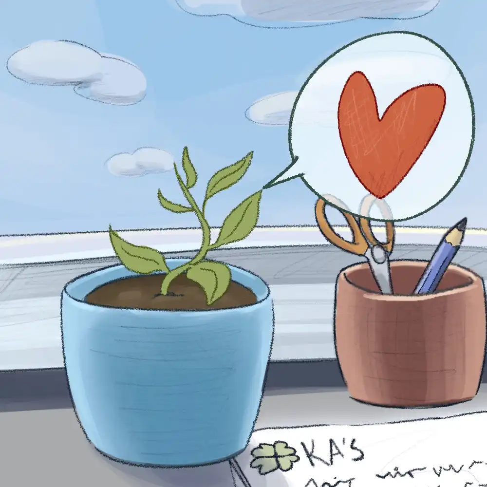

This is a virtual plant that I made using JS, HTML and CSS. It's essentially a Tamagotchi but with only one need: water. The plant will grow while it has water or die if it doesn't get water for a long time.
